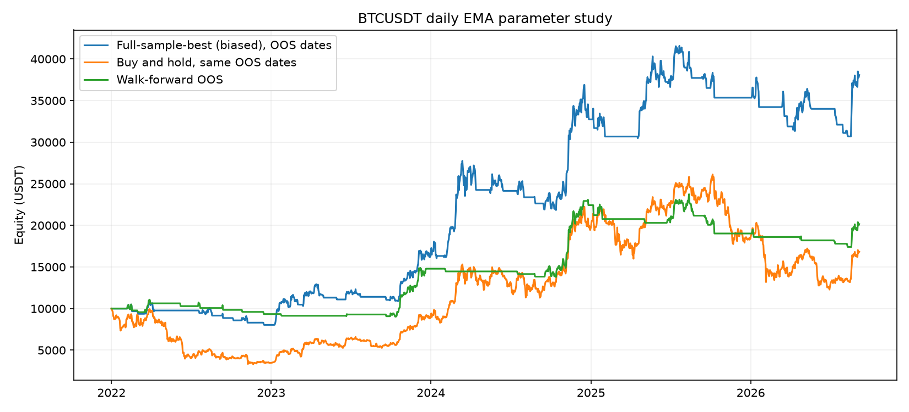
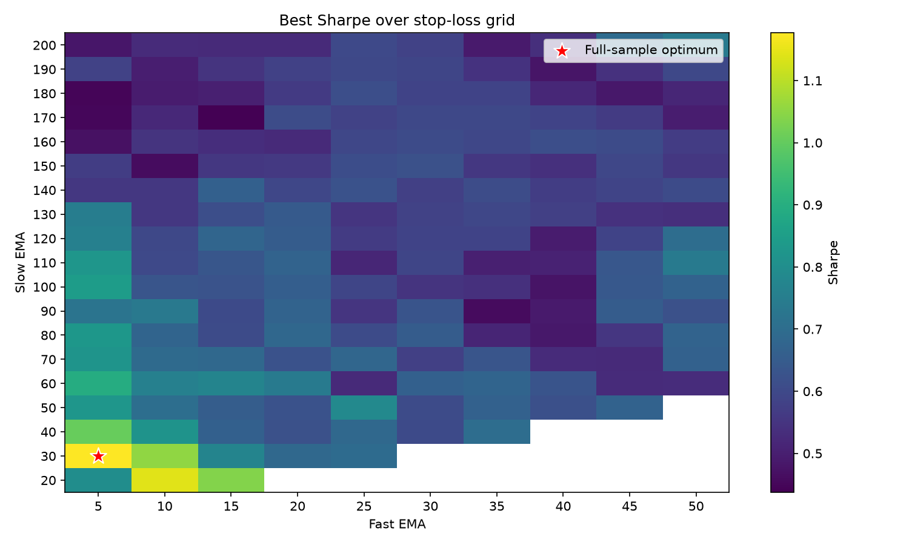

# Walk-forward Robustness Sample

**Sample project for research and demonstration only. Not financial advice. No live trading.**

This project evaluates whether an EMA crossover with a fixed percentage stop appears overfit on BTCUSDT daily candles. It uses a transparent pandas event loop, a full-sample parameter heatmap, and rolling walk-forward windows. It never connects to trading endpoints.

## Method

The tested grid uses fast EMA 5–50 by 5, slow EMA 20–200 by 10 where fast < slow, and stops 2%–10% by 1%. Parameters rank by daily Sharpe. Walk-forward training covers the prior 365 calendar days, test covers the next 90 days, and the window advances by 90 days. The sample reports in-sample optimization separately from out-of-sample segments. EMA values are seeded from each window's first close; orders signaled at a close fill at the next open. A stop becomes active after the entry bar, fills at the stop unless the open gaps below it, and fees are 0.1% per side.

| Item | Implementation |
|---|---|
| EMA | `ewm(span=n, adjust=False)` |
| Crossover | Current and prior EMA comparisons |
| Execution | Next candle open after close signal |
| Stop | Daily OHLC check, gap-through at open |
| Score | Annualized daily Sharpe, 365 periods |

## Run

```bash
python3 -m venv .venv && .venv/bin/pip install -r requirements.txt
.venv/bin/pytest -q
.venv/bin/python -m sample.run --offline
.venv/bin/python -m sample.run
```

Offline mode uses 800 completed daily BTCUSDT candles in `data/sample_btcusdt_1d.csv`, downloaded from Binance's public klines API (`https://api.binance.com/api/v3/klines`, no key) for 2024-09-01 through 2026-11-09. That produces four complete 365-day training / 90-day test windows. Online mode downloads Binance public BTCUSDT daily klines from 2021-01-01 and writes to `reports/online/`. Network failures terminate with an error; the online mode does not fall back to the CSV. Offline and online outputs live in separate directories.

## Overfitting diagnostics

The report also calculates **PBO** with combinatorially symmetric cross-validation (CSCV): it estimates how often the in-sample winner ranks below the median out of sample across complementary time-block splits. **DSR** adjusts the selected strategy's daily Sharpe for the number and spread of tested parameter sets, sample length, skewness, and kurtosis. These are diagnostics, not guarantees; the tested grid shares one BTC history, so trial independence is only an approximation.

Implementation follows Bailey, Borwein, López de Prado, and Zhu, [“The Probability of Backtest Overfitting” (2017)](https://doi.org/10.21314/JCF.2016.322), and Bailey and López de Prado, [“The Deflated Sharpe Ratio” (2014)](https://doi.org/10.3905/jpm.2014.40.5.094). PBO uses 16 equal time segments and all 12,870 complementary 8-of-16 splits. Tied out-of-sample scores receive average ranks. The two PBO plots and the full numeric summary are embedded in each generated report.

## Example results

Online run retrieved 2,139 completed daily candles through 2026-11-09. The OOS comparison covers 2022-01-01 through 2026-09-06. The full-sample-best column is deliberately biased because those parameters were selected using the entire history.

| Metric | Full-sample best (biased) | Walk-forward OOS | Buy and hold, same OOS dates |
|---|---:|---:|---:|
| Total return | 280.67% | 101.53% | 68.35% |
| Sharpe | 1.072 | 0.865 | — |
| Maximum drawdown | -26.18% | -26.70% | — |
| Positive OOS windows | — | 6 / 19 | — |

Although stitched walk-forward return exceeded buy and hold in this run, only 6 of 19 windows were positive and mean per-window OOS Sharpe was -0.612. The concatenated OOS/IS Sharpe efficiency was 0.552; PBO was 0.298 and DSR was 0.903. Together with a 24.25% mean neighbor Sharpe decay, this is mixed evidence and does not establish a stable edge. Current generated results are in `reports/online/report.md`; offline results are in `reports/offline/report.md`.





## Limitations

This is a small educational example. Daily OHLC bars cannot establish intraday event order. The engine omits slippage, funding, taxes, liquidity limits, outages, partial fills, and short positions. EMA warm-up is finite and restarts at each training period. Sharpe on short histories is unstable; grid search creates selection bias, and overlapping training windows are dependent. PBO's time-block splits are not independent market samples, and the DSR's trial-count approximation treats correlated grid trials imperfectly. No independent TradingView reconciliation is included. Historical performance is not a forecast.

## License

MIT. See `LICENSE`.
