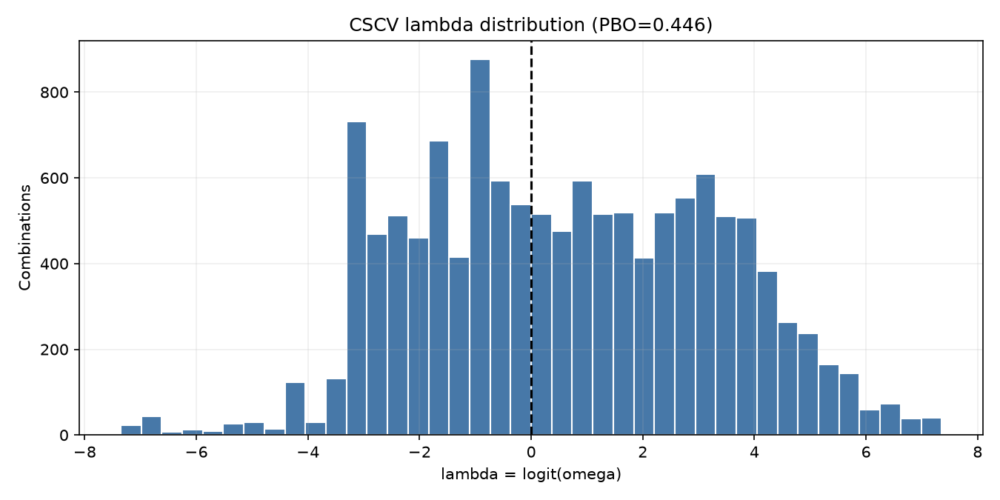
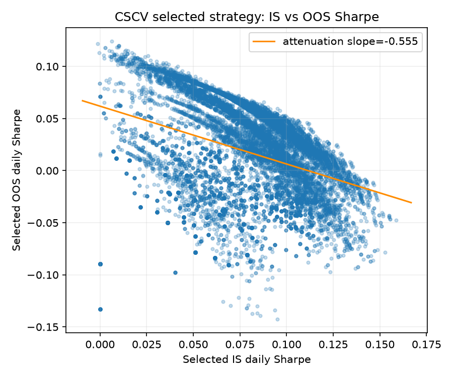

# Walk-forward robustness report

Research demonstration only; historical performance is not predictive.

Data: bundled offline CSV; 800 bars (2024-09-01 to 2026-11-09).

## Full-sample grid

Grid: fast EMA 5–50 step 5; slow EMA 20–200 step 10 with fast < slow; stop 2%–10% step 1%. Best full-sample parameters: fast=5, slow=40, stop=2%. This is an in-sample selection and is shown as a biased benchmark.

## Comparable out-of-sample period

The walk-forward OOS span is 2025-09-01 to 2026-08-26. The full-sample optimum uses all dates to select its parameters, so its OOS-span result is a deliberately biased reference. Buy-and-hold uses the same OOS dates.

| Metric | Full-sample-best, same OOS span (biased) | Walk-forward OOS | Buy and hold, same OOS span |
|---|---:|---:|---:|
| Total return | 6.27% | -0.34% | -27.66% |
| Sharpe | 0.446 (biased) | 0.032 (stitched OOS) | — |
| Max drawdown | -11.75% (biased) | -14.79% | — |
| OOS windows | — | 4 | — |

Walk-forward status: completed. Each completed window optimizes only on the immediately preceding 365 calendar days and tests on the following 90 days, stepping 90 days.

## Robustness

- Best point neighborhood: **isolated peak** (3 grid points within 10% of optimum in its ±1-step fast, slow, and stop neighborhood).
- **Secondary:** mean per-window Sharpe efficiency (OOS / IS): 1.468; median: -1.507. Ratios are unstable when in-sample Sharpe is near zero.
- **Primary stitched efficiency:** concatenated OOS Sharpe 0.032 / concatenated IS Sharpe 1.061 = 0.030.
- Mean per-window OOS Sharpe: -0.906; positive-return OOS windows: 1 / 4.
- Parameter drift, RMS step-to-step: fast period 4.082; slow period 11.547; stop fraction 0.0000.
- Neighbor Sharpe decay (±1 grid step in fast, slow, and stop): 45.09%

## Overfitting diagnostics

CSCV uses 12,870 complementary 8-of-16 segment splits over 1,566 parameter trials. PBO = **0.446** (fraction of selected in-sample winners with out-of-sample lambda <= 0); IS-to-OOS Sharpe attenuation slope = **-0.555**. Equal scores use average ranks, so a complete tie has omega=0.5 and lambda=0. DSR for the full-sample winner: raw daily Sharpe **0.06960** (annualized **1.330**), SR0 **0.07472**, skewness **1.436**, Pearson kurtosis **12.215**, DSR **0.440**. A DSR at or below 0.5 cannot distinguish this Sharpe from a multiple-testing winner under this approximation.

## Conclusion

The evidence is mixed and does not establish a stable edge: stitched walk-forward OOS returned -0.34% versus -27.66% for buy-and-hold over the same dates, stitched Sharpe efficiency was 0.030, only 1 of 4 windows were positive, mean window OOS Sharpe was -0.906, PBO was 0.446, and DSR was 0.440. The full-sample optimum is selected using future observations and is not independent evidence.

The stop-loss dimension is included in optimization; the heatmap shows best Sharpe across stop values and marks the optimum. Fees are 0.1% per side; slippage, funding, taxes, liquidity and intraday price ordering are not modeled.
