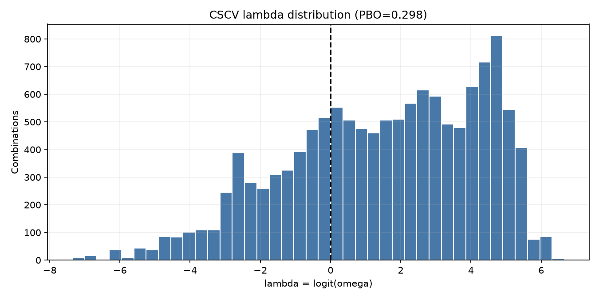
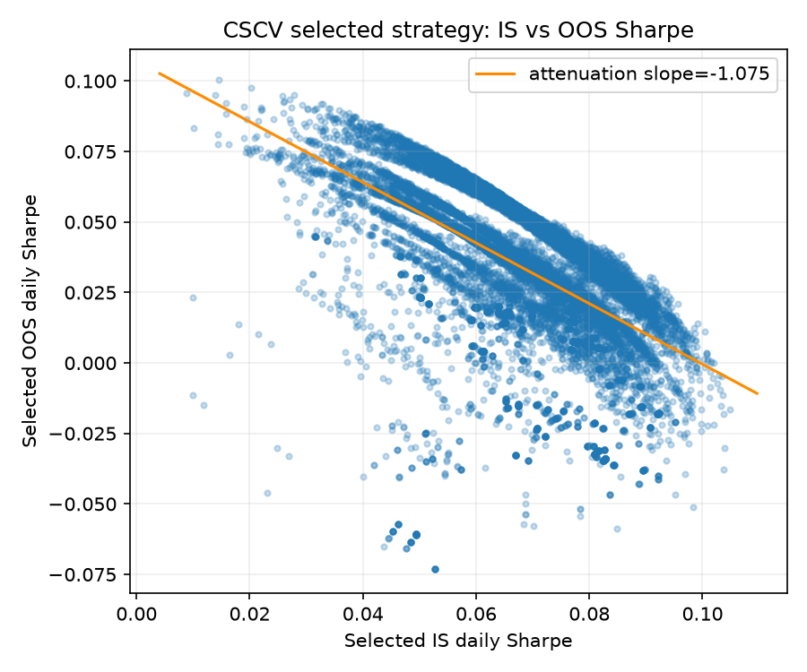

# Walk-forward robustness report

Research demonstration only; historical performance is not predictive.

Data: Binance BTCUSDT daily from 2021-01-01; 2139 bars (2021-01-01 to 2026-11-09).

## Full-sample grid

Grid: fast EMA 5–50 step 5; slow EMA 20–200 step 10 with fast < slow; stop 2%–10% step 1%. Best full-sample parameters: fast=5, slow=30, stop=3%. This is an in-sample selection and is shown as a biased benchmark.

## Comparable out-of-sample period

The walk-forward OOS span is 2022-01-01 to 2026-09-06. The full-sample optimum uses all dates to select its parameters, so its OOS-span result is a deliberately biased reference. Buy-and-hold uses the same OOS dates.

| Metric | Full-sample-best, same OOS span (biased) | Walk-forward OOS | Buy and hold, same OOS span |
|---|---:|---:|---:|
| Total return | 280.67% | 101.53% | 68.35% |
| Sharpe | 1.072 (biased) | 0.865 (stitched OOS) | — |
| Max drawdown | -26.18% (biased) | -26.70% | — |
| OOS windows | — | 19 | — |

Walk-forward status: completed. Each completed window optimizes only on the immediately preceding 365 calendar days and tests on the following 90 days, stepping 90 days.

## Robustness

- Best point neighborhood: **isolated peak** (3 grid points within 10% of optimum in its ±1-step fast, slow, and stop neighborhood).
- **Secondary:** mean per-window Sharpe efficiency (OOS / IS): -7.155; median: -1.081. Ratios are unstable when in-sample Sharpe is near zero.
- **Primary stitched efficiency:** concatenated OOS Sharpe 0.869 / concatenated IS Sharpe 1.575 = 0.552.
- Mean per-window OOS Sharpe: -0.612; positive-return OOS windows: 6 / 19.
- Parameter drift, RMS step-to-step: fast period 16.116; slow period 60.231; stop fraction 0.0100.
- Neighbor Sharpe decay (±1 grid step in fast, slow, and stop): 24.25%

## Overfitting diagnostics

CSCV uses 12,870 complementary 8-of-16 segment splits over 1,566 parameter trials. PBO = **0.298** (fraction of selected in-sample winners with out-of-sample lambda <= 0); IS-to-OOS Sharpe attenuation slope = **-1.075**. Equal scores use average ranks, so a complete tie has omega=0.5 and lambda=0. DSR for the full-sample winner: raw daily Sharpe **0.06158** (annualized **1.176**), SR0 **0.03451**, skewness **1.321**, Pearson kurtosis **15.386**, DSR **0.903**. DSR exceeds 0.5 under this approximation; it does not provide independent confirmation or override walk-forward evidence.

## Conclusion

The evidence is mixed and does not establish a stable edge: stitched walk-forward OOS returned 101.53% versus 68.35% for buy-and-hold over the same dates, stitched Sharpe efficiency was 0.552, only 6 of 19 windows were positive, mean window OOS Sharpe was -0.612, PBO was 0.298, and DSR was 0.903. The full-sample optimum is selected using future observations and is not independent evidence.

The stop-loss dimension is included in optimization; the heatmap shows best Sharpe across stop values and marks the optimum. Fees are 0.1% per side; slippage, funding, taxes, liquidity and intraday price ordering are not modeled.
